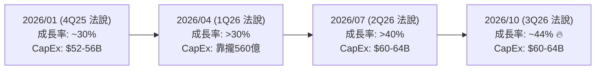

# 台積電 (2330) 2026 Q3 法說會實績與指標達成率視覺化展示專案

[](https://www.tsmc.com)
[](#-一-2026-第三季-3q26-核心指標達成率總表)
[%20%2B%203nm%20(33%25)-3B82F6?style=for-the-badge)](#-三-先進製程與應用平台結構演變-1q26--3q26)
[](https://megkenhuang-ctrl.github.io/tsmc-2026-q3-report/)

本專案彙整台積電（TSMC, 2330.TW / NYSE: TSM）於 **2026 年 10 月 15 日** 召開之 **2026 年第三季（3Q26）法人說明會**最新財務實績，並結合 **Google NotebookLM 筆記本 (`TSMC 1Q26 Earnings: AI Surge and Record Financial Growth`)** 內部收錄之 1Q26 / 2Q26 法說會指引、7 月份營收進度及外資研究報告進行完整交叉比對與達成率分析。

本專案同時提供**現代化響應式互動 Web 儀表板**與**16:9 專業版 PowerPoint 簡報**。

---

## 🌐 線上即時展示 (Live Demo)

👉 **[點此造訪 GitHub Pages 線上互動儀表板](https://megkenhuang-ctrl.github.io/tsmc-2026-q3-report/)**
- 支援 **USD（美元）/ NTD（新台幣）** 一鍵即時幣別切換與動態圖表重繪
- 支援 **深色 (Dark) / 淺色 (Light)** 主題無縫切換
- 內建 Print CSS，支援一鍵「列印 / 匯出 PDF」評析報告

---

## 📂 專案檔案清單

| 檔案路徑 | 類型 | 說明 |
| :--- | :---: | :--- |
| **[`index.html`](./index.html)** | 🌐 Web | 現代化互動式財務儀表板核心（Tailwind CSS + Chart.js + Lucide Icons） |
| **[`app.js`](./app.js)** | 💻 腳本 | 儀表板前端邏輯、雙幣別動態計算、四組圖表動態渲染與分頁切換 |
| **[`style.css`](./style.css)** | 🎨 樣式 | 科技感深色半透明毛玻璃特效、列印排版與主題樣式 |
| **[`data/tsmc_3q26_data.json`](./data/tsmc_3q26_data.json)** | 📊 資料 | 結構化 1Q26–4Q26 財務數據、製程佔比、平台佔比與資本支出資料庫 |
| **[`TSMC_2026_Q3_法說會實績與指標達成率比對報告.pptx`](./TSMC_2026_Q3_法說會實績與指標達成率比對報告.pptx)** | 📊 簡報 | 6 頁 16:9 寬螢幕專業版法人級 PowerPoint 簡報檔 |
| **[`generate_ppt.js`](./generate_ppt.js)** | 💻 腳本 | 使用 `pptxgenjs` 自動化生成簡報之 Node.js 腳本 |
| **[`package.json`](./package.json)** | ⚙️ 設定 | 專案依賴管理與本機即時預覽伺服器腳本 |

---

## 📊 一、 2026 第三季 (3Q26) 核心指標達成率總表

| 核心指標 | NotebookLM 內載 3Q26 財測指引 (7月法說) | 3Q26 法說會最新實績 (2026/10/15) | 對比財測中位數達成率 | 對比財測高標達成率 | 達成狀態評析 |
| :--- | :---: | :---: | :---: | :---: | :--- |
| **美元合併營收** | **446 ~ 458 億美元**<br>*(中位數 452 億美元)* | **467.2 億美元**<br>*(季增 +16.2% / 年增 +41.2%)* | **103.36%** | **102.01%** | 🔥 **飛越財測高標** (+9.2 億美元)，AI 與 N2/N3 需求爆發 |
| **新台幣合併營收** | **1.427 兆 ~ 1.465 兆元**<br>*(中位數 1.446 兆元)* | **1 兆 4,942.4 億元**<br>*(季增 +17.6% / 年增 +50.9%)* | **103.31%** | **101.95%** | 🔥 **飛越財測高標** (+286 億元)，單季逼近 1.5 兆大關 |
| **毛利率 (GM)** | **65.0% ~ 67.0%**<br>*(中位數 66.0%)* | **66.4%**<br>*(季減 1.3 ppts)* | **100.61%**<br>*(+0.40 ppt)* | **99.10%**<br>*(-0.60 ppt)* | ✅ **超越財測中位數**（抵銷 N2 初期量產稀釋，高稼動率護航） |
| **營業利益率 (OPM)** | **56.0% ~ 58.0%**<br>*(中位數 57.0%)* | **58.7%**<br>*(季減 1.6 ppts)* | **102.98%**<br>*(+1.70 ppts)* | **101.21%**<br>*(+0.70 ppt)* | 🔥 **飛越財測高標**（營業槓桿極佳、費用控管卓越） |
| **匯率假設 (USD/NTD)** | **32.00** | **31.98** (實際平均) | **99.94%** | — | 匯率貼合假設，財報無匯兌扭曲 |
| **稅後純益 / EPS** | *(2Q26 實績為 27.25 元)* | **7,630.6 億元 / 29.43 元** | — | — | 🏆 **單季獲利逼近 8,000 億，前三季累計 EPS 達 78.76 元** |

> 📌 **NotebookLM 7月營收驗證：**
> 筆記本來源《台積電七月營收優於預期》載明 7 月營收為 NT$ 4,675.8 億（達成 Q3 財測中位數 32.3%）；最終 3Q26 實績達 1.494 兆元，換算 8、9 月單月平均達 NT$ 5,133.3 億元，完全印證季末拉貨動能加速衝刺！

---

## 📈 二、 第二季 (2Q26) 指標達成率回顧與三季成長軌跡

| 核心指標 | 1Q26 實際數 | 2Q26 財測指引 (筆記本紀錄) | 2Q26 實際數 | 2Q26 達成率 (中位數 / 高標) | 3Q26 實際數 | 3Q26 vs 2Q26 (QoQ) |
| :--- | :---: | :---: | :---: | :---: | :---: | :---: |
| **美元營收** | 359.0 億美元 | 390 ~ 402 億美元 | **402.0 億美元** | **101.52% / 100.00%** | **467.2 億美元** | **+16.2%** |
| **新台幣營收** | 1 兆 1,341.0 億元 | 1.236 兆 ~ 1.274 兆元 | **1 兆 2,703.8 億元** | **101.20% / 99.69%** | **1 兆 4,942.4 億元** | **+17.6%** |
| **毛利率 (GM)** | 66.2% | 65.5% ~ 67.5% | **67.7%** | **101.80% / 100.30%** | **66.4%** | **-1.3 ppts** |
| **營業利益率 (OPM)** | 58.1% | 56.5% ~ 58.5% | **60.3%** | **104.87% / 103.08%** | **58.7%** | **-1.6 ppts** |
| **稅後純益 / EPS** | 5,724.8 億 / 22.08 元 | — | **7,065.6 億 / 27.25 元** | — | **7,630.6 億 / 29.43 元** | **+8.0%** |

- **前三季累計營收**：NT$ 3 兆 8,987.2 億元
- **前三季累計純益**：NT$ 2 兆 0,421.0 億元
- **前三季累計 EPS**：**NT$ 78.76 元**

---

## 🔬 三、 先進製程與應用平台結構演變 (1Q26 $\rightarrow$ 3Q26)

### 1. 晶圓銷售製程佔比演進 (By Technology)
- **2 奈米 (N2)**：由 1Q26 的 `0%` ➔ 2Q26 的 `~3%` ➔ **3Q26 正式放量達 `8%`** 🚀（單季貢獻約 37 億美元）
- **3 奈米 (N3)**：由 1Q26 的 `25%` 大幅提升至 **3Q26 的 `33%`** 📈（躍居第一大營收主力）
- **5 奈米 (N5)**：1Q26 `36%` ➔ 2Q26 `~32%` ➔ 3Q26 `28%`
- **7 奈米 (N7)**：1Q26 `13%` ➔ 2Q26 `~11%` ➔ 3Q26 `10%`
- **先進製程 ($\le 7\text{nm}$) 合計**：1Q26 `74%` ➔ 2Q26 `~76%` ➔ **3Q26 `79%`**

### 2. 應用平台分佈與成長率 (By Platform)
- **高效能運算 (HPC)**：**68%**（QoQ **+22%**），AI GPU 與雲端 ASIC 需求爆發，為帶動創高的絕對引擎。
- **智慧型手機 (Smartphone)**：**21%**（QoQ **+10%**），旗艦新機備貨進入旺季，實質金額穩健成長。
- **車用電子 (Automotive)**：**4%**（QoQ **+23%**），ADAS / 自駕晶片需求強勢回溫。
- **物聯網 (IoT)**：**4%**（QoQ **+5%**）。
- **消費性電子及其他**：**3%**。

---

## 📈 四、 2026 全年三度上修與資本支出演進



- **全年營收年增率預估**：年初預估 `~30%` ➔ 4月首修 `>30%` ➔ 7月二修 `>40%` ➔ **10月三度上修至 `~44%`**（累計上修達 +14 個百分點）。
- **全年資本支出 (CapEx)**：由 Q1 的 `520~560 億美元` 上調並維持於 **`600~640 億美元`** 高檔區間。
- **董事長魏哲家關鍵論述**：
  > 「幾乎所有 AI 創新者都在與台積電合作。AI 需求依然是真實的（Real），而且需求遠遠超過我們的供給。2026 到 2028 年的三年資本支出規模，將顯著超越過去三年的 1,010 億美元水準；台積電獲利能力沒有天花板。」

---

## 🔮 五、 第四季 (4Q26) 最新財測指引

* **美元營收**：**523 ~ 543 億美元**（中位數 533 億美元，季增 `+14.1%`、年增 `+58%`）
* **台幣營收**：**1.66 兆 ~ 1.73 兆元**（匯率基準 `1 USD = 31.8 NTD`，中位數約 1.695 兆）
* **毛利率**：**65.0% ~ 67.0%**（中位數 `66.0%`）
* **營業利益率**：**56.5% ~ 58.5%**（中位數 `57.5%`）

---

## 🚀 本機執行方式

### 1. 直接開啟網頁
直接在檔案總管中雙擊 [`index.html`](./index.html) 即可於瀏覽器完整檢視並操作所有互動圖表。

### 2. 使用本機伺服器
```bash
# 啟動本機伺服器
npm start

# 或使用 Python
python -m http.server 8080
```
瀏覽器開啟 `http://localhost:3000` 或 `http://localhost:8080`。

### 3. 生成 PowerPoint 簡報
```bash
npm install
npm run generate-ppt
```

---

## 📄 資料來源與版權聲明
- 本專案資料來源依據台積電官方公佈之 2026 年第三季法人說明會公開資料（2026/10/15）以及 Google NotebookLM 知識庫資料庫模型比對。
- 本專案僅供研究、學術討論與資料視覺化展示參考，不構成任何投資建議。
